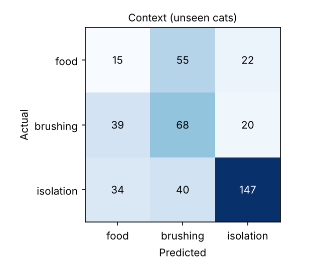
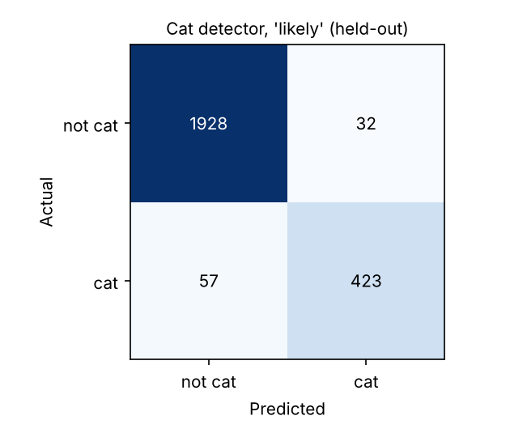

# MeowMemo model card (live demo model)

Version `meowmemo-web-20261026-1907`. Features from features.js (the same code in training and in the page): MFCC + delta statistics, spectral shape, pitch (YIN), duration, at 8 kHz, band-limited to 100-3,400 Hz so results do not depend on how a clip was resampled.

## What it does
1. **Cat detector**: is this clip a cat vocalization? Answers likely / uncertain / not detected.
2. **Context matcher**: which of three CatMeows recording situations does the meow most resemble:
   waiting for food, being brushed, or alone in an unfamiliar room.

## What it does not do
It does not translate meows, read emotions, or detect pain or illness. The three situations are how the
recordings were collected, not what the cats felt. Real life has many more situations than three.

## Context matcher
Model: forest. 440 meows from 21 cats ({'food': 92, 'brushing': 127, 'isolation': 221}).
Evaluation: **leave-one-cat-out (21 folds)**. Each cat is tested by a model that never heard that cat.

| Metric | Macro-F1 |
|---|---|
| This model, unseen cats | **0.45** |
| Always guess the most common situation | 0.22 |
| Random guessing | 0.33 |
| Same model, random clip split (leaky, for comparison only) | 0.66 |

Accuracy on unseen cats: 52%. The leaky number is higher because the same cat's
other meows end up in training; it is not a fair estimate and the app does not use it.

Confusion matrix (rows = actual, columns = predicted):

| | food | brushing | isolation |
|---|---|---|---|
| **food** | 15 | 55 | 22 |
| **brushing** | 39 | 68 | 20 |
| **isolation** | 34 | 40 | 147 |

**Abstaining.** If the top situation's probability is below 0.5, the app says it is unsure
and lists all competitive situations instead of naming one.

| Threshold | Clips answered | Accuracy when answering |
|---|---|---|
| 0.4 | 80% | 55% |
| 0.5 | 35% | 70% |
| 0.6 | 13% | 81% |
| 0.7 | 3% | 100% |

Per-cat accuracy ranges from 19% to 80%, so results vary a lot by cat.

## Cat detector
Model: gradient_boosting, scored on individual sound events (a clip counts as its most cat-like sound).
Clip duration is excluded because it identified the dataset, not the animal: an earlier version
caught 0% of ESC-50 cats. 480 cat clips (CatMeows + ESC-50 cat class) vs 1960 other
ESC-50 sounds. Evaluation: 5-fold grouped (cats and ESC-50 folds held out); sound events, clip = most cat-like event.

| Metric (held-out data) | Value |
|---|---|
| F1 when saying "likely" | 0.90 |
| Precision when saying "likely" | 93% |
| Recall when saying "likely" (all cats) | 88% |
| Recall on CatMeows cats | 90% |
| Recall on ESC-50 cats (different recordings) | 65% |
| ESC-50 cats at least "uncertain" (not dismissed) | 65% |
| Dog clips wrongly called "likely cat" | 0% |
| Human-sound clips wrongly called "likely cat" | 5% |
| Share of clips: likely / uncertain / not detected | 19% / 1% / 81% |

Thresholds: "likely" at p >= 0.6, "not detected" below 0.3, "uncertain" between.
The gap between CatMeows recall and ESC-50 cat recall shows how much the detector depends on recording conditions.

## Data and licences
- CatMeows (Ludovico et al., Zenodo 4008297): research / non-commercial use. 21 cats (Maine Coon and European Shorthair), recorded in Italy at 8 kHz.
- ESC-50 (Piczak, 2015): CC BY-NC 3.0. 2,000 five-second clips, 50 classes, 40 cats.
This project is non-commercial coursework. A commercial version would need new, licensed data.

## Known limitations
- Tiny dataset: two breeds, one country, one microphone setup, three situations.
- Phone microphones, background noise and distance differ from the training recordings.
- No numeric confidence is shown to users, because the probabilities are not calibrated for real homes.
- Next research step: test whether an owner's own labelled examples improve accuracy for their cat over this generic baseline.
